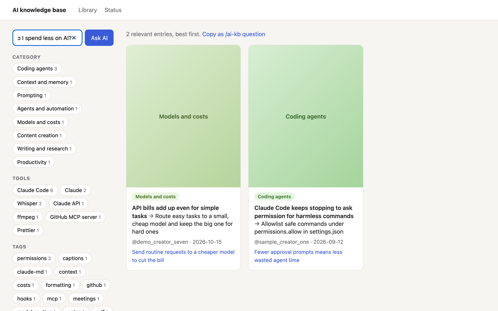
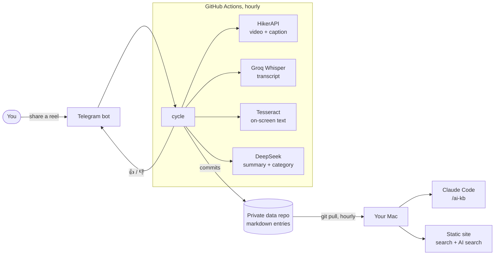
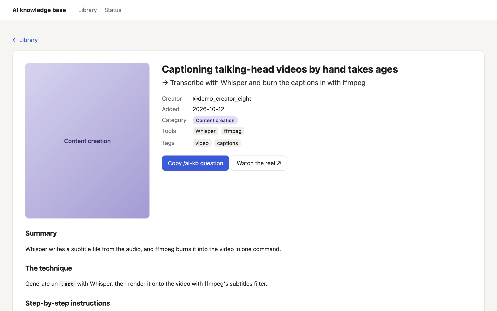

# InstaAutomation

**Turn the AI tips you save on Instagram into a searchable knowledge base that Claude Code can use.**

[](https://github.com/ncr08/InstaAutomation/actions/workflows/ci.yml)
[](https://ncr08.github.io/InstaAutomation/)

[](LICENSE)

You see a reel with a great Claude Code trick, share it with a Telegram bot, and forget about it. Within the hour it has been downloaded, transcribed, read off the screen, summarised into step-by-step instructions, filed under a category and committed to a private Git repo. The bot reacts 👍. From then on:

- **Claude Code knows it.** A short block of your best techniques is imported into Claude's global instructions, and `/ai-kb how do I…` answers from the whole library with concrete steps and sources.
- **You can browse it.** A static site, rebuilt every hour on your Mac, opens from a bookmark with no server running. It has search, filters, and **AI search**: ask a question, get the relevant reels ranked, each with a reason.

**[Try the live demo →](https://ncr08.github.io/InstaAutomation/)** (made-up entries, AI search off)



## How it works



1. **Inbox.** The cycle reads new messages from the bot, keeps only reel links from you, and queues them in a state file before touching any paid API, so a crash can never lose a reel.
2. **Processing.** For each reel: fetch the video and caption, transcribe the audio, OCR sampled frames for on-screen code and commands, then have DeepSeek write a structured entry (problem → approach, steps, prerequisites, caveats, tools, tags) and pick a category from the ones you defined.
3. **Storage.** Each reel becomes one markdown file with YAML frontmatter, plus its cover image. The index and the Claude block are regenerated from those files every cycle, so hand edits like pinning just work.
4. **Failure handling.** A failed reel is retried at most three times, at least 8 hours apart, so a temporary outage doesn't burn its attempts. After that you get a 👎 with the reason. If a whole run fails, the bot messages you a link to the logs.
5. **On your Mac.** A launchd job pulls the knowledge base and rebuilds the site every hour, at login and after wake. A Claude Code `SessionStart` hook pulls it too, so Claude always has the latest entries.

## Screenshots

| Entry page | AI search |
| --- | --- |
|  |  |

## Engineering notes

- **Ports and adapters.** The pipeline core only talks to small interfaces (inbox, reel source, transcriber, screen reader, summarizer, cover maker, clock). Every external service has a thin adapter, and the tests run the real core against in-memory fakes, covering crashes mid-cycle, expired Telegram updates, malformed model output, retries and duplicate shares.
- **No server, no framework.** The site is plain HTML written by a Python build step, with a few hundred lines of vanilla JavaScript for search and filters. It works opened straight from disk. AI search calls DeepSeek directly from the page; there is no backend to host.
- **Write once, never rewrite.** The model writes each entry once. Nothing is merged or regenerated by an LLM later, so advice can't silently disappear. Combining tips across reels is left to `/ai-kb` at question time.
- **Defensive by default.** Model output is validated before anything is written. Markdown is rendered without raw HTML, and entry text can't break out of the page. The Telegram adapter drops anything not sent by the owner before the core ever sees it.
- **Tested.** About 150 tests (pytest, strict mypy), run on every push, plus opt-in smoke tests against the live services.

## Security

The code is public; everything personal is not.

| What | Where it lives | Never in |
| --- | --- | --- |
| API keys and bot token | GitHub Actions secrets on the private data repo, and a local gitignored `.env` | this repo, its history, or the demo |
| Your knowledge base, covers and queue state | the private data repo, cloned locally as `kb/` (gitignored here) | this repo |
| The built site (contains the DeepSeek key for AI search) | `site/` on your Mac only (gitignored) | anywhere online |

- CI runs [gitleaks](https://github.com/gitleaks/gitleaks) over the full history on every push, and GitHub secret scanning with push protection is on.
- The workflow's failure message is sent with the bot token as a masked secret, and errors never print request URLs.
- The live demo is built in CI with the DeepSeek key explicitly blanked, and the build fails if AI search settings show up in it.
- Only messages from your own Telegram user ID are processed; everyone else is ignored.

## Run your own

You need a Mac (for the launchd job), Python 3.12 with [uv](https://docs.astral.sh/uv/), the [GitHub CLI](https://cli.github.com/), and accounts for Telegram, [HikerAPI](https://hikerapi.com/), [Groq](https://console.groq.com/) and [DeepSeek](https://platform.deepseek.com/).

1. **Fork and clone this repo.**
2. **Create a private data repo** for your knowledge base, and clone it into `kb/` inside your clone.
3. **Copy the cycle workflow** from [`docs/data-repo/cycle.yml`](docs/data-repo/cycle.yml) into the data repo as `.github/workflows/cycle.yml`, and change the `repository:` line to your fork.
4. **Run the setup wizard:** `scripts/setup-wizard.sh`. It walks you through creating the Telegram bot and stores each key as a secret on your data repo.
5. **Install locally:** `python3 scripts/install_claude.py`. It imports the Claude block into `~/.claude/CLAUDE.md`, links the `/ai-kb` skill, adds the pull hook, and installs the hourly site job. It prints the bookmark for your site.

Then share a reel with your bot. `python3 scripts/install_claude.py --uninstall` removes the site job.

## Project layout

```
src/instaautomation/   pipeline core, adapters, site builder
skills/ai-kb/          the /ai-kb Claude Code skill
scripts/               setup wizard and local installer
demo/kb/               made-up knowledge base for the live demo
tests/                 unit tests, fixtures and opt-in smoke tests
```

## License

[MIT](LICENSE)
